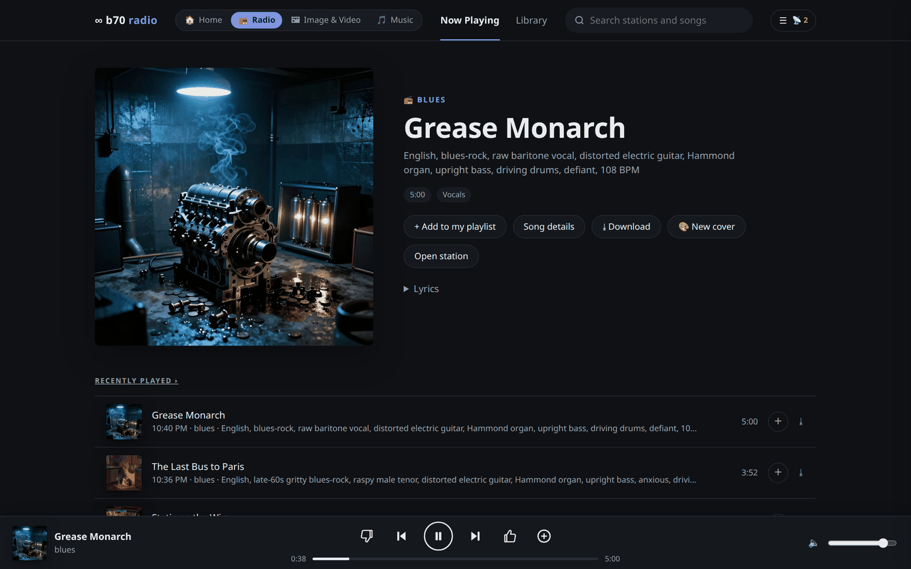
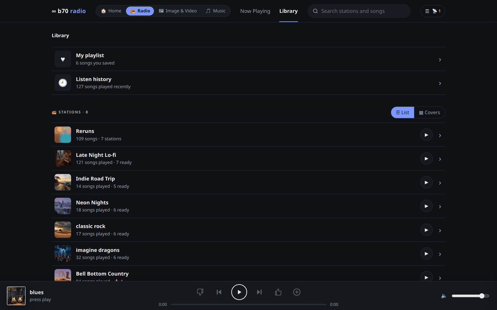
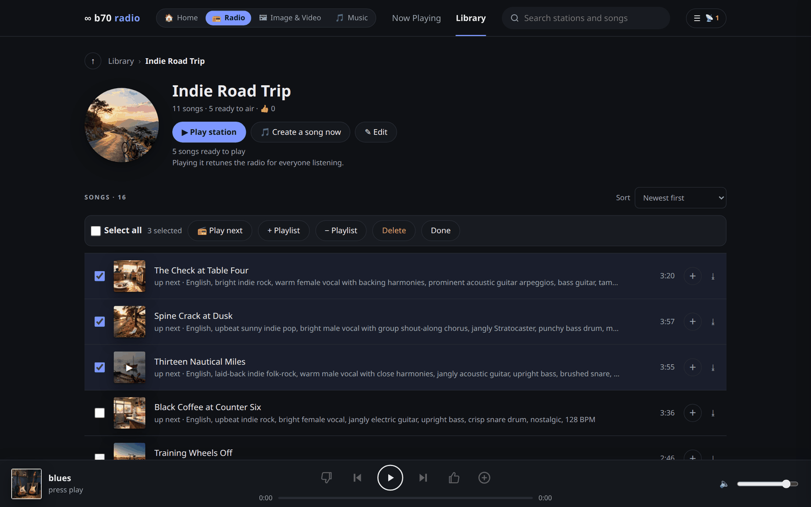
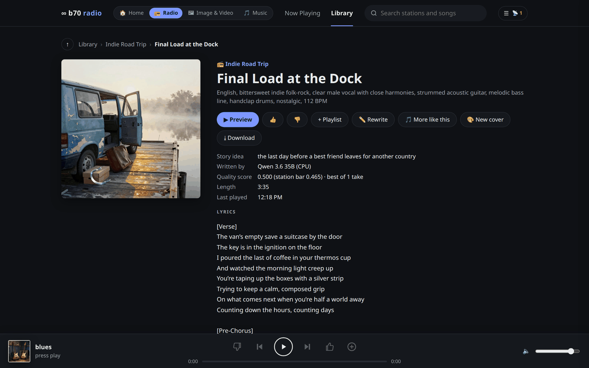
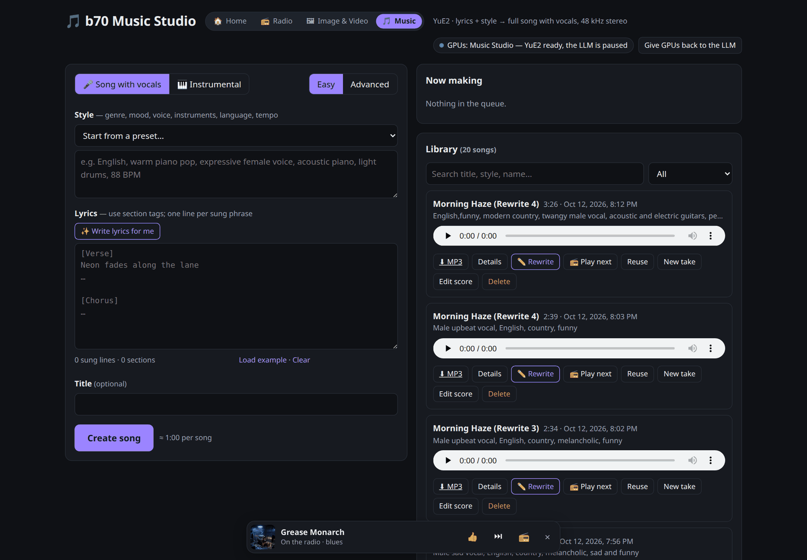
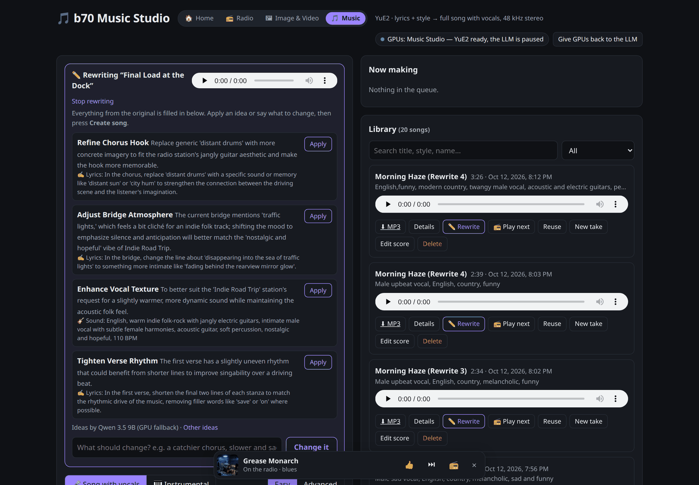
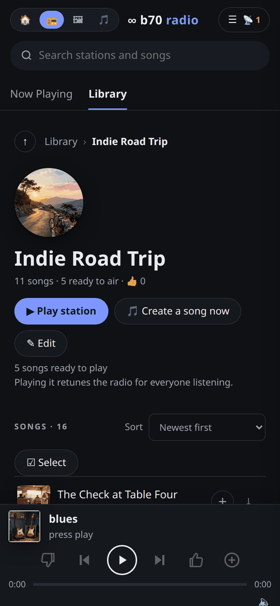
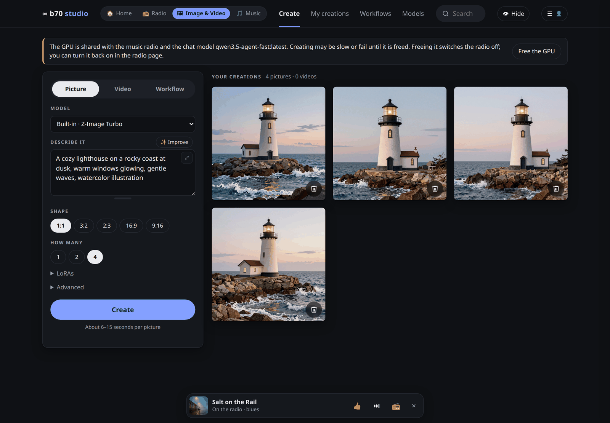
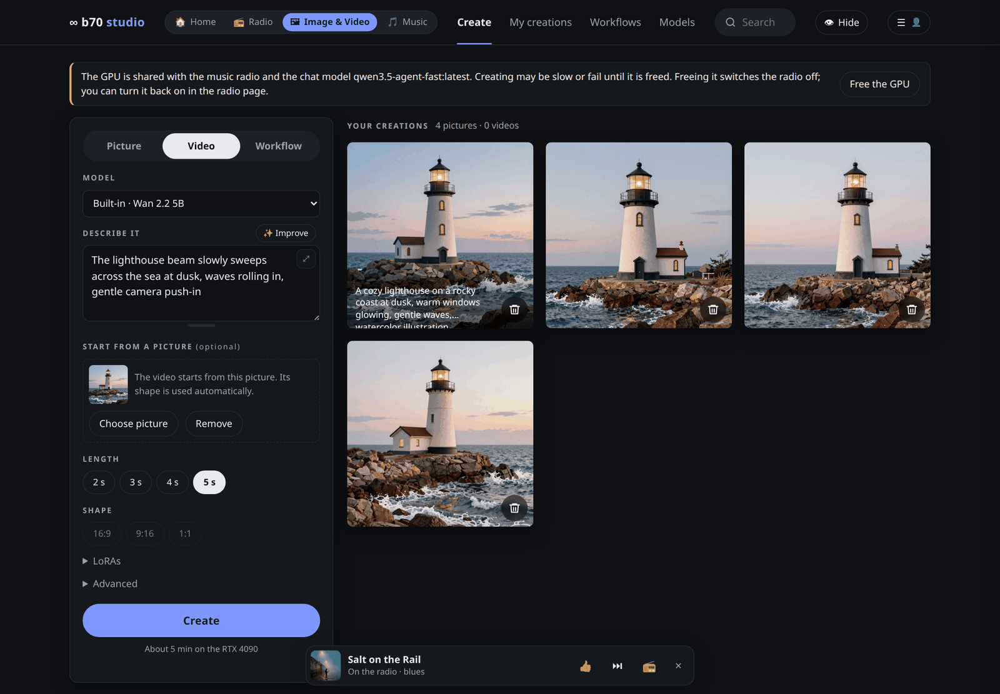
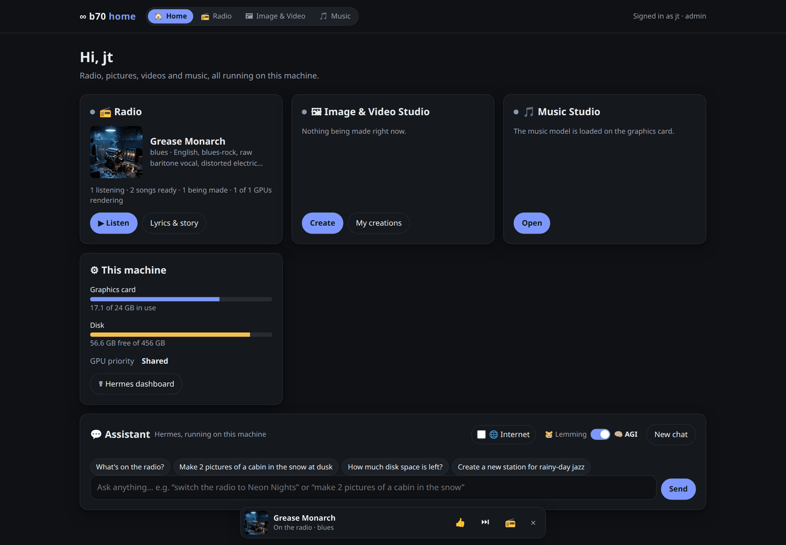

# Agentora

**Endless AI radio and a home media studio on one NVIDIA card.** Every station writes, sings and draws its own songs with [YuE2](https://github.com/multimodal-art-projection/YuE), local LLMs and Z-Image, and learns what you like from your thumbs. A Music Studio, an Image & Video Studio and a Home page with a local AI assistant sit beside it, all one click apart.

Agentora is a fork of [zebgop-ops/yue2-xpu-radio](https://github.com/zebgop-ops/yue2-xpu-radio), which ran on two Intel Arc Pro B70 cards. This fork runs on a single **RTX 4090** with [Ollama](https://ollama.com), and redesigns the radio around a cleaner, folder-style library. **[What's new in Agentora →](docs/whats-new.md)**



## The apps

| Radio: library | Radio: a station | Radio: a song |
|---|---|---|
|  |  |  |
| Your playlist, listen history and every station, laid out like folders | All of a station's songs, sortable, with **Select all** to play next, save or delete | Lyrics, the story idea, quality score, cover art, ✏️ **Rewrite** and **More like this** |

| Music Studio (Easy mode) | ✏️ Rewrite a song | Radio on a phone |
|---|---|---|
|  |  |  |
| Style, lyrics, Create. **Advanced** shows every control | Opened from a song: everything prefilled, AI ideas apply in one click | Plays over Bluetooth in the car, ⏮ ⏭ from the lock screen |

| Image Studio | Video Studio | Home |
|---|---|---|
|  |  |  |
| Pictures with Z-Image Turbo, ✨ Improve for prompts, LoRAs, ComfyUI workflows | Videos with Wan 2.2, from text or starting from one of your pictures | What's on, GPU and disk, and a chat with the local Hermes assistant |

The **radio and Music Studio** are in this repository (`studio/`). The **Image & Video Studio and Home page** are a companion app (a small aiohttp front end over ComfyUI on port 7870) in a separate repository, not published yet. They share one look and an app switcher (`/b70/b70.css`, `/b70/b70.js`), so moving between apps keeps the radio playing in its own tab.

## What it does

- **Stations that write their own songs.** Describe a station ("bell-bottom country, sassy female vocals") or teach it with a folder of songs. For each song an LLM writes a title, a style line and lyrics built around one clear story. An editor pass makes sure every line makes sense, and YuE2 sings it at 48 kHz. A CLAP critic keeps the best of 2–3 takes.
- **It learns from you.** 👍, 👎, skips, playlist saves and even how long you listen become short taste notes the songwriter follows. **More like this** on any song writes a new one in its spirit.
- **Cover art for every station and song**, drawn between songs by Z-Image Turbo from a name-free description of the music, so there's no text or band likenesses.
- **One live broadcast.** Everyone hears the same 192 kbps MP3 stream (`/radio/stream.mp3`). A 15 s cushion rides out Wi-Fi and mobile hiccups, ⏭ and ⏮ cut over in about a second, ⏮ walks back through the station's history like any player, and **📻 Play next** queues any song in the library.
- **A library laid out like folders:** Library › station › song, with a path bar, an ↑ button, and previous/next inside each folder.
- **✏️ Rewrite.** Open any song in the Music Studio with its settings and lyrics filled in. Get 3–4 specific AI suggestions, or type what should change ("slower and sadder, about a brother"), apply with one click, then record.
- **Shares one GPU politely.** YuE2, the GPU lyricist, ComfyUI and the chat assistant take turns on the card, and a **GPU priority** switch (Radio / Studio / Assistant / Shared) decides who waits.
- **Classic deck.** The original cassette-deck player is still at `/radio/classic`.

## How it works

```
 station + taste notes ──> songwriter (Qwen 3.6 35B, CPU) ──┐     GPU lyricist (Qwen 3.6 27B) pre-writes
                                                            ├──> songs into a bank while the card is free
                            lyric editor pass ──────────────┘
                                   │ spec: title · style · lyrics · story
                                   v
                       job queue ──> YuE2 on cuda:0 (2–3 takes) ──> CLAP critic + audio checks
                                                                           │ approved
                                                                           v
   ComfyUI Z-Image ──> cover art        spool (6 ahead) ──> playout (real-time, 15 s lead, clean cuts)
                                                                           │ MP3 feed (127.0.0.1:7862)
            radio service (port 7860, restartable) ────────────────────────┼──────────────────────────────
                                                                           v
            stream relay (port 7861, its own service): listeners, 15 s cushion, stream position, silence bridge
                                                                           │
                                     /stream.mp3 ──> radio page · phones · VLC (same audio)
```

Two services, so the music keeps playing through a restart of the radio:

- **The radio** (`yue2-studio`, port 7860) writes, records, judges and chooses songs, paces the audio in real time and feeds it to the relay. It also serves the pages and the API.
- **The stream relay** (`agentora-stream`, port 7861) holds every listener's connection, the burst buffer a new listener starts with, and the stream position. If the feed pauses for most of a cushion (the radio restarting takes about 10 s), it plays silence so no player runs dry. `/radio/stream.mp3` on port 7860 redirects to it, so old links and players keep working.

The code, by job:

| File | What it does |
|---|---|
| `studio/app.py` | HTTP server (stdlib), job queue, GPU worker processes and hand-off, lyrics writer, ✏️ rewrite suggestions |
| `studio/radio.py` | starts the radio, routes `/api/radio/*`, and forwards `radio.NAME` to the module that owns it |
| `studio/radio_state.py` | shared state and every setting (changed live by `settings.py`); other modules read them as `rs.NAME` |
| `studio/radio_stations.py` | create / edit / analyze stations (CLAP + librosa), ✨ Improve / 💡 Suggest |
| `studio/radio_songwriter.py` | song specs, the lyric editor, the GPU lyricist's bank, taste notes from thumbs |
| `studio/radio_spool.py` | keeps songs ready: queues takes, the CLAP critic, audio checks |
| `studio/radio_broadcast.py` | playout, pacing, the feed to the relay, ⏭ ⏮ 📻 play next, listening signals |
| `studio/radio_library.py` | songs, history, playlist, feedback, next track and reruns, on/off |
| `studio/stream_relay.py` | the stream relay (stdlib only) |
| `studio/gpu_broker.py` | the GPU broker: leases for every GPU user, and the Ollama proxy Hermes talks to (stdlib only) |
| `studio/speech_server.py` | the speech service: Qwen3-TTS voice (GPU, under a lease) and whisper listening (GPU, CPU fallback), both under leases, OpenAI-compatible |
| `studio/art.py`, `studio/assistant.py`, `studio/settings.py` | cover art (ComfyUI), the chat panel (Hermes), ⚙ settings |
| `studio/radio.html` + `studio/web/radio-*.js` | the radio page: core, player, library, panel, extras (plain scripts, no build step) |
| `studio/index.html` | the Music Studio |
| `studio/logsetup.py` | logging for every component |
| `tests/e2e_radio.py`, `tests/e2e_ui.py` | end-to-end tests (below) |

## Hardware and software

- NVIDIA GeForce RTX 4090 (24 GB), AMD Ryzen 9 3900X, 60 GB RAM, Ubuntu 26.04 (kernel 7.0)
- PyTorch 2.14 (CUDA 13), YuE2 (`m-a-p/YuE2-3B` + VAE), CLAP `laion/clap-htsat-unfused` (CPU), ffmpeg
- Ollama 0.40 with three models (created from Modelfiles, below)
  - `qwen3.6-songwriter`: Qwen 3.6 35B-A3B on the **CPU** (`num_gpu 0`), so writing never fights the GPU
  - `qwen3.6-agent`: Qwen 3.6 27B on the GPU, used as the lyricist; it's the same loaded copy as the assistant's "AGI" model
  - `qwen3.5-agent-fast`: Qwen 3.5 9B on the GPU, for the fast fallback writer, ✏️ rewrite ideas and Improve
- Optional: ComfyUI with Z-Image Turbo (cover art), [Hermes Agent](https://github.com/NousResearch/hermes-agent) (chat panel)

## Setup (one NVIDIA GPU)

```bash
# 1. YuE2 (unpatched on NVIDIA; patches/yue2-xpu.patch is only for Intel XPU)
git clone https://github.com/multimodal-art-projection/YuE.git ~/YuE
cd ~/YuE && git checkout 1dc1c50
python3.12 -m venv ~/venv-yue2
~/venv-yue2/bin/pip install torch --index-url https://download.pytorch.org/whl/cu130
~/venv-yue2/bin/pip install -e ~/YuE librosa soundfile transformers
sudo apt install ffmpeg

# 2. the songwriter models
ollama pull qwen3.6:35b-a3b && ollama pull qwen3.6:27b && ollama pull qwen3.5:9b
printf 'FROM qwen3.6:35b-a3b\nPARAMETER num_ctx 8192\nPARAMETER num_gpu 0\n' > Modelfile && ollama create qwen3.6-songwriter -f Modelfile
printf 'FROM qwen3.6:27b\nPARAMETER num_ctx 65536\n' > Modelfile && ollama create qwen3.6-agent -f Modelfile
printf 'FROM qwen3.5:9b\nPARAMETER num_ctx 65536\n' > Modelfile && ollama create qwen3.5-agent-fast -f Modelfile

# 3. the stream relay (keeps listeners connected through a restart of the radio) and the GPU broker
cp ~/yue2-xpu-radio/systemd/agentora-{stream,gpu}.service ~/.config/systemd/user/
systemctl --user daemon-reload && systemctl --user enable --now agentora-stream agentora-gpu
# point Hermes (or any OpenAI-compatible tool) at the broker's Ollama proxy: base_url http://127.0.0.1:11435/v1

# 4. run the radio (or install systemd/yue2-studio.service)
~/yue2-xpu-radio/start-local.sh
```

Players connect to the relay on port 7861, so open that port wherever you expose 7860 (here: the Tailscale/LAN relay).

Open `http://<host>:7860/radio` (radio) or `http://<host>:7860/` (Music Studio). `nvidia-local.patch` holds the changes to `app.py` that make it run on CUDA; it's already applied on this branch.

Optional, and it makes the 27B model fit fully on a 24 GB card: `OLLAMA_KV_CACHE_TYPE=q8_0` and `OLLAMA_FLASH_ATTENTION=1` in Ollama's service environment.

### Configuration

| Variable | Here | Meaning |
|---|---|---|
| `STUDIO_DEVICES` | `cuda:0` | one YuE2 worker per device |
| `STUDIO_LYRICS_LLMS` | songwriter (CPU), then `qwen3.5-agent-fast` (GPU) | `base_url\|model\|label`, comma-separated, tried in order; a label containing "GPU" is preferred for quick jobs |
| `STUDIO_LLM_EXTRA` | `{"reasoning_effort": "none"}` | added to every LLM request (skips Ollama's thinking step) |
| `STUDIO_LLM_UNIT` | *(empty)* | a systemd LLM unit to pause for the GPU; not needed with Ollama |
| `RADIO_TAKES` / `RADIO_AHEAD` | `2` / `6` | takes per song (the critic keeps the best); songs kept ready |
| `RADIO_BURST_SECONDS` | `15` | how far the stream runs ahead, i.e. each player's cushion |
| `STUDIO_DATA` | `~/yue2-xpu-radio/library` | the song library; radio state lives next to it |
| `RADIO_RELAY_PORT` / `RADIO_RELAY_FEED` | `7861` / `7862` | where players connect / where the radio feeds the relay |
| `LOG_LEVEL` / `LOG_DIR` | `INFO` / `logs/` | log level (`DEBUG` adds every web request) and where the log files go |

Most radio and audio settings (bitrate, loudness, EQ, quality steps, takes, writers, cover art) can also be changed live on the radio page under ☰ → Settings.

### Radio API (selection)

| | |
|---|---|
| `GET :7861/stream.mp3` | the live broadcast, from the stream relay (`/radio/stream.mp3` on :7860 redirects there) |
| `GET /api/radio/state` | stations, what's on air, what's being made, GPU owner, play-next list |
| `POST /api/radio/power` `{on, station}` | switch on/off or retune |
| `POST /api/radio/skip` `{track, kind}` / `POST /api/radio/back` `{track, steps}` | ⏭ / ⏮ (steps 0 = restart the song, 1 = previous) |
| `POST /api/radio/upnext` `{ids}` | 📻 play these library songs next |
| `POST /api/radio/feedback` `{track, kind}` | `keep` / `skip` / `dislike` / `clear` |
| `GET /api/radio/stations/<id>/history?limit=500&upcoming=1` | every song of a station, the ones waiting to air first |
| `POST /api/radio/stations/<id>/song` `{like}` | write and record a song now (optionally "more like" a song) |
| `POST /api/rewrite/suggest` `{id, ask}` | ✏️ ideas for rewriting a song, or turn a request into edits |

## Sharing the GPU

One 24 GB card serves the radio's music model (YuE2, about 10–13 GB while it records), ComfyUI (pictures, videos, cover art), and the chat models (the 27B "AGI" needs about 18–21 GB with its 64k context). Not everything fits at once, and a model that loads into whatever is left runs partly on the CPU, several times slower, for as long as it stays loaded. **The GPU broker** (`studio/gpu_broker.py`, service `agentora-gpu`) decides who gets the card:

- **Every GPU user takes a lease**: who it is, roughly how much memory it needs, and whether a person is waiting (the assistant, the Image & Video Studio) or it's background work (the radio's recordings, cover art, the lyricist). The radio and the Studio ask the broker directly. Hermes reaches Ollama through the broker's **Ollama proxy** (`127.0.0.1:11435`), which takes leases on its behalf, so the chat panels, the Hermes dashboard, the terminal and cron jobs are all covered.
- **To grant a lease, the broker makes room** using real measurements (`nvidia-smi`): background work stops starting new pieces and gives the card back (the radio finishes the take in progress, then unloads YuE2; the music keeps playing from its spool of ready songs), an idle ComfyUI unloads, and idle Ollama models unload.
- **The order follows "Who goes first"** in the ☰ panel. With *Shared*, a person waiting beats background work; *Radio*, *Image & Video Studio* or *Assistant* puts that one first.
- **A chat keeps the card for 3 minutes after its last message** (`BROKER_ASSISTANT_IDLE`), then the radio carries on. A Studio job keeps it while ComfyUI is busy.
- **Models squeezed partly onto the CPU are reloaded fully** as soon as there's room, only when more room has appeared since the last try.
- **✨ Auto** (the chat's middle setting) uses the 27B model when it can have the card within about 3 seconds, and otherwise answers right away with the 9B model, which always fits.
- **More GPUs, more tools:** devices come from `nvidia-smi` and leases are per device, so a second card is picked up automatically. A new tool takes a lease with `POST :7890/lease {client, kind, mem_mb, wait_s}`. `GET :7890/status` shows the cards, leases and who is being asked to wait.

Using ComfyUI's own page (port 8188) directly bypasses the broker; everything the Studio sends goes through it.

## Speech

`studio/speech_server.py` (service `agentora-speech`, `127.0.0.1:7895`, in its own environment `~/venv-speech`) gives Hermes, the chat panels and any other tool a voice and ears, through the OpenAI audio API:

- **Voice:** `POST /v1/audio/speech {input, voice?, instructions?, response_format?}`.
  - It uses **Qwen3-TTS 1.7B VoiceDesign**, the voice engine of the Jim-o-Lantern talking pumpkin. A voice is *described in words*, and a fixed seed keeps it the same every time.
  - Voices: `agentora` (default, warm and friendly), `narrator`, `bright`, `jack` (the pumpkin), or any description passed in `instructions`.
  - It runs on the GPU under a broker lease (about 5 GB, which fits beside the radio) and unloads after 2 minutes unused (`SPEECH_IDLE`).
  - The first sentence takes about 9 s to load; after that, a 7 s sentence takes about 2 s.
- **Listening:** `POST /v1/audio/transcriptions` (multipart `file`, any format ffmpeg reads, including a browser's WebM recording) → `{text}`. It uses **whisper small.en** on the GPU (float16, about 1 GB, its own lease `speech-ears`): about 0.1 s for a short phrase once loaded, about 1 s for the first one. It unloads after 2 minutes unused, like the voice. If the card has no room it listens on the CPU instead (int8, about 2 s) and moves back to the GPU once there is room. Whisper's CTranslate2 is built for CUDA 12 while the voice's torch is CUDA 13, so CUDA 12's cuBLAS is installed beside the venv (`uv pip install --python ~/venv-speech/bin/python --target ~/venv-speech/cu12 nvidia-cublas-cu12`) and loaded by path; `SPEECH_STT_DEVICE=cpu` keeps listening off the card.
- **Hermes** uses it for both directions: `tts.provider` and `stt.provider` are `openai` with `base_url: http://127.0.0.1:7895/v1`. Its speech tools are still switched off per platform (`hermes tools enable tts|stt --platform …`).

```bash
uv venv --python 3.12 ~/venv-speech
uv pip install --python ~/venv-speech faster-qwen3-tts "qwen-tts-hf<0.2,>=0.1.1.post1" "transformers==5.15.1" "setuptools<81" faster-whisper soundfile numpy
cp systemd/agentora-speech.service ~/.config/systemd/user/ && systemctl --user enable --now agentora-speech
```

## Logs

Every component logs the same way: a level and the component's name on every line, to the systemd journal and to a rotating file (5 MB × 5).

| Component | Journal | File |
|---|---|---|
| Radio + Music Studio (and each module: `radio_spool`, `radio_broadcast`, `art`…) | `journalctl --user -u yue2-studio` | `logs/radio.log` |
| YuE2 GPU workers | (same journal) | `logs/yue2-worker.log` |
| Stream relay | `journalctl --user -u agentora-stream` | `logs/stream.log` |
| GPU broker (leases, the Ollama proxy) | `journalctl --user -u agentora-gpu` | `logs/gpu-broker.log` |
| Speech service | `journalctl --user -u agentora-speech` | `logs/speech.log` |
| Image & Video Studio, Hermes gate (companion app) | `-u genstudio`, `-u hermes-gate` | `~/genstudio/logs/studio.log`, `hermes-gate.log` |
| Tailscale/LAN relay | `-u tailnet-relay` | `~/.local/state/tailnet-relay/relay.log` |

Plain lines are INFO, lines about failures are WARNING, and tracebacks (including uncaught errors in any thread or request) are ERROR. A client closing a connection isn't logged as an error. Set `LOG_LEVEL=DEBUG` in a service to log every request.

## Tests

End-to-end tests against the running services. Run them while nobody is listening: they play, skip and queue songs, which moves the broadcast for everyone. Anything they change is put back.

```bash
~/venv-yue2/bin/python tests/e2e_radio.py              # pages, API, library, settings, stream, skip, back, play next, log (~1 min)
~/venv-yue2/bin/python tests/e2e_radio.py --restart    # + restarts the radio while listening: the stream must not stop
~/venv-yue2/bin/python tests/e2e_radio.py --full       # + ✨ Improve, ✏️ rewrite ideas, and one song made start to finish (minutes)
python tests/e2e_ui.py                                 # headless browser (Playwright): every page and flow, no JS errors
```

`--quick` skips the broadcast tests, so it's safe while people listen.

## Things we learned the hard way

This fork's additions; the original project's lessons follow below.

- **Coherent lyrics need to be asked for.** Prompts that pushed "concrete details" and banned clichés produced vivid nonsense ("a bowl of cold light", "cast iron butter"). Putting one clear story and plain language first, letting the editor check sense before style, and relaxing over-strict title rules fixed it. A spec with only section tags and no sung lines also has to be rejected, or the model sings nothing.
- **Clean cuts mean reconnects.** Dropping the buffered old song on ⏭ makes the new one start in a second, but every player then reconnects. Anything that cuts must not fire for fillers, and the playout must not treat the instant between disconnect and reconnect as "everyone left".
- **Phones freeze silent background tabs.** When a stream drops, the player keeps a silent clip looping while it retries, so Android doesn't suspend the page.
- **Web Audio and Bluetooth don't mix on Android.** Routing the stream through Web Audio (for EQ and VU meters) crackled over car Bluetooth; phones now default to plain playback.
- **Restarting shouldn't mean silence.** Splitting the stream into its own small service, which owns the listeners and the stream position, lets the radio restart in the middle of a song: listeners stay connected, a silence bridge covers the gap, and the next song follows. The test restarts the radio while listening and requires no pause over 3 s.
- **Big refactors need a referee.** The radio was split from one 2,000-line file into modules mechanically, with Python's own symbol tables deciding which names are global, and checked by end-to-end tests run before and after (identical results).
- **One GPU, many guests.** Sharing one loaded copy of a model between the lyricist and the assistant avoids reloads, and a 35B model that doesn't fit is slower than a 9B that does. With a 24 GB card, what *fits* matters more than parameter count.

### From the original yue2-xpu-radio

- **A device fault poisons a process forever.** Workers restart on `DEVICE_LOST` or 3 consecutive failures and retire after repeated faults.
- **The length cap was cutting songs off.** The radio uses 300 s as a safety cap, sizes lyrics for about 2.5–3 min with an `[Outro]`, and fades out any take that still ends loud.
- **CLAP saturates within a genre**, so it's a soft novelty penalty, not a dedup; variety has to come from the songwriter prompt.
- **Liked songs over-anchor**: likes set the vibe only.
- **CLAP tags can be badly wrong**; passing the learned songs' names to the LLM fixes a station's sound.
- **Real-time MP3 pacing**: 192 kbps at 48 kHz gives 576-byte frames, so byte offsets are time offsets and cuts land on frame boundaries.

The Intel XPU port (`patches/yue2-xpu.patch`: XPU graphs, sync/RNG/cache, no AR offload before the VAE) is unchanged from the original; see its history for details.

## Credits and licenses

- Original project: [yue2-xpu-radio](https://github.com/zebgop-ops/yue2-xpu-radio) by zebgop-ops. Code in this repository: Apache-2.0 (see `LICENSE`).
- [YuE2](https://github.com/multimodal-art-projection/YuE) by M-A-P: code Apache-2.0; the model weights have their own license (`MODEL_LICENSE` upstream). Check it before using generated music.
- [Qwen](https://huggingface.co/Qwen) models by Alibaba, Z-Image Turbo and Wan 2.2 through [ComfyUI](https://github.com/comfyanonymous/ComfyUI), [CLAP](https://huggingface.co/laion/clap-htsat-unfused) by LAION, [Hermes Agent](https://github.com/NousResearch/hermes-agent) by Nous Research. Idea: [infinite-tapedeck](https://github.com/CharlesMod/infinite-tapedeck) by CharlesMod.
- Songs you upload to learned stations, and everything the stations make, stay on your machine; none of it is part of this repository.
